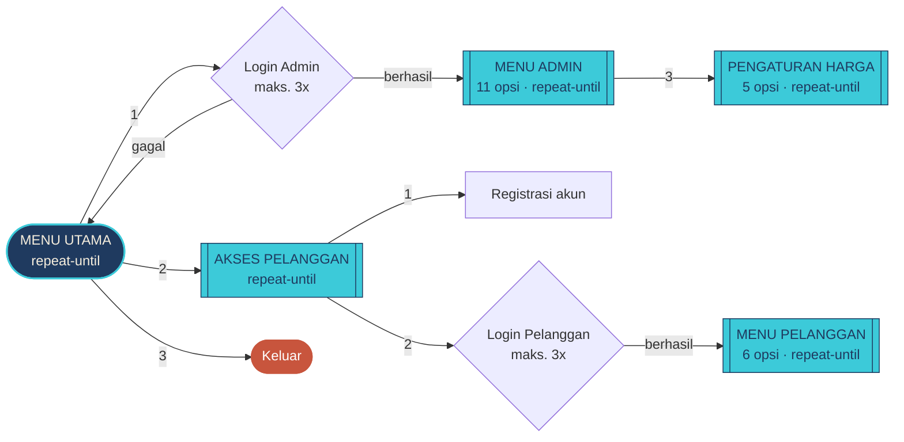
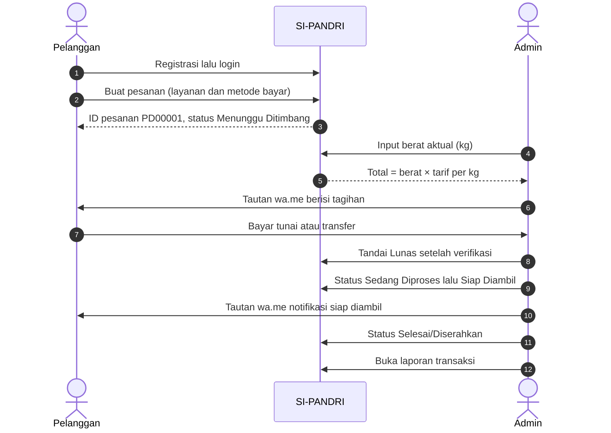
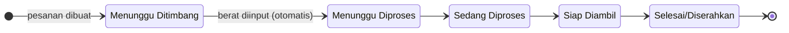

<!-- ===================================================================== -->
<!--  SI-PANDRI · Sistem Pengelolaan Parfait Laundry                        -->
<!--  UTS Dasar Pemrograman (DP2) · Ilmu Komputer Fasilkom-TI USU 2026/2027 -->
<!-- ===================================================================== -->

<div align="center">


<a href="https://syamaydev.github.io/SI_PANDRI_OP/game/"></a>

<a href="https://syamaydev.github.io/SI_PANDRI_OP/game/">
  
</a>

<br/>


<br/>

**[🎮 Mainkan Game](https://syamaydev.github.io/SI_PANDRI_OP/game/)** &nbsp;·&nbsp;
**[🧩 Source Game](https://github.com/SyamayDev/SI_PANDRI_OP/tree/main/game)** &nbsp;·&nbsp;
**[🧾 Source Pascal](SI_PANDRI.pas)** &nbsp;·&nbsp;
**[🧠 Penerapan Materi](#-penerapan-materi-dasar-pemrograman)** &nbsp;·&nbsp;
**[🚀 Cara Menjalankan](#-cara-menjalankan)** &nbsp;·&nbsp;
**[📸 Dokumentasi PDF](Run-Terminal-SI-PANDRI.pdf)**

</div>

<br/>

> [!NOTE]
> **Proyek UTS Dasar Pemrograman (DP2)** · Semester Ganjil T.A. 2026/2027
> Program Studi Ilmu Komputer · Fakultas Ilmu Komputer dan Teknologi Informasi · Universitas Sumatera Utara
> Unit Ilmu Komputer Laboratory Center (IKLC) · Dikembangkan oleh **Tim SEPAKAT**

<br/>

## 📑 Daftar Isi

| | Bagian | | Bagian |
|:-:|:--|:-:|:--|
| 01 | [📖 Tentang Proyek](#-tentang-proyek) | 07 | [🎮 Game Presentasi Interaktif](#-game-presentasi-interaktif) |
| 02 | [👥 Anggota Kelompok](#-anggota-kelompok) | 08 | [📂 Struktur Repositori](#-struktur-repositori) |
| 03 | [📊 Proyek dalam Angka](#-proyek-dalam-angka) | 09 | [🚀 Cara Menjalankan](#-cara-menjalankan) |
| 04 | [✨ Fitur Utama Aplikasi](#-fitur-utama-aplikasi) | 10 | [🧪 Pengujian](#-pengujian) |
| 05 | [🧠 Penerapan Materi Dasar Pemrograman](#-penerapan-materi-dasar-pemrograman) | 11 | [📸 Dokumentasi dan Tangkapan Layar](#-dokumentasi-dan-tangkapan-layar) |
| 06 | [🔄 Alur Kerja Sistem](#-alur-kerja-sistem) | 12 | [⚠️ Keterbatasan](#️-keterbatasan) · [📜 Lisensi](#-lisensi-dan-kredit) |

---

## 📖 Tentang Proyek

**SI-PANDRI (Sistem Pengelolaan Parfait Laundry)** adalah sistem administrasi laundry berbasis *command-line* yang ditulis dengan **Free Pascal**. Program ini menangani alur operasional laundry dari awal sampai akhir: registrasi dan login pelanggan, pemesanan, penimbangan berat, perhitungan biaya otomatis, pelacakan status cucian, pembayaran, penyiapan pesan WhatsApp, sampai laporan transaksi. Semua data disimpan permanen di file lokal `.dat`.

Untuk presentasi UTS, aplikasi ini dilengkapi **game web interaktif berbasis narasi**, *"SI-PANDRI: Misi Laundry Beres!"*. Dalam 9 babak, audiens mengikuti **Bu Ratna**, pemilik Parfait Laundry yang kewalahan mengurus semuanya secara manual, sampai laundry-nya lebih teratur berkat SI-PANDRI. Game ini dibangun dengan HTML, CSS, dan JavaScript murni, tanpa server dan tanpa library.

> *"Hari baru setengah jalan, tapi kepala saya sudah penuh catatan dan angka..."*
> — **Bu Ratna**, Babak 1

### 🧩 Dua Komponen, Satu Cerita

| Aspek | 🖥️ Aplikasi SI-PANDRI | 🎮 Game "Misi Laundry Beres!" |
|:--|:--|:--|
| **Peran** | Produk utama untuk operasional laundry | Media presentasi dan pembelajaran |
| **Teknologi** | Free Pascal 3.2.2 (CLI) | HTML5 · CSS · Vanilla JavaScript |
| **Penyimpanan** | File biner `pandri_*.dat` (`file of record`) | `localStorage` browser (progres, XP, achievement) |
| **Pengguna** | Admin laundry dan pelanggan | Audiens kelas dan presenter |
| **Cara menjalankan** | `fpc SI_PANDRI.pas` lalu `SI_PANDRI.exe` | [Mainkan secara online](https://syamaydev.github.io/SI_PANDRI_OP/game/) atau unduh source game untuk mode offline |
| **Data** | Data nyata yang diinput pengguna | Seluruhnya fiktif |

> [!IMPORTANT]
> Game adalah **simulasi terpisah**. Game tidak menjalankan `SI_PANDRI.exe`, tidak membaca atau mengubah file `.dat`, tidak mengirim WhatsApp, dan tidak memproses pembayaran. Penghubung materi di antara keduanya adalah **cuplikan kode Pascal asli** yang ditampilkan di Babak 7. Pada repositori pengembangan, cuplikan tersebut diselaraskan dari `SI_PANDRI.pas` menggunakan skrip ekstraksi.

---

## 👥 Anggota Kelompok

<div align="center">

### Tim SEPAKAT

| No | Nama Lengkap | NIM | KOM | Lab |
|:-:|:--|:-:|:-:|:-:|
| 1 | *Syahril Maimubdy* | *261401130* | *A* | *LAB DP2* |
| 2 | *Sabitha Sarah* | *261401124* | *A* | *LAB DP2* |
| 3 | *Gilbert Kindly* | *261401127* | *A* | *LAB DP2* |

</div>

| Keterangan | Detail |
|:--|:--|
| 📚 Mata Kuliah | Dasar Pemrograman (DP2) |
| 📝 Jenis Evaluasi | Ujian Tengah Semester: presentasi proyek kelompok |
| 🗓️ Periode | Semester Ganjil T.A. 2026/2027 |
| 🏛️ Institusi | Program Studi Ilmu Komputer, Fasilkom-TI, Universitas Sumatera Utara |
| 🔬 Laboratorium | Unit Ilmu Komputer Laboratory Center (IKLC) |

---

## 📊 Proyek dalam Angka

<div align="center">

| 🧾 1.566 | 🧩 60 | 🗂️ 15 | 🎬 9 | 🏆 11 | ✅ 131 |
|:-:|:-:|:-:|:-:|:-:|:-:|
| baris kode Pascal | prosedur dan fungsi | fitur operasional | babak cerita | achievement | uji otomatis lulus |

</div>

---

## ✨ Fitur Utama Aplikasi

<table>
<tr>
<td width="33%" valign="top">

### 🔐 Akun dan Login
Registrasi dengan validasi lengkap, username unik, dan login yang dibatasi **3 percobaan** untuk admin maupun pelanggan.

</td>
<td width="33%" valign="top">

### ⚖️ Timbang dan Hitung
Berat aktual 0,01–500 kg diinput admin. Total dihitung otomatis: **berat × tarif per kg** sesuai layanan.

</td>
<td width="33%" valign="top">

### 🔄 Status Bertahap
Status cucian hanya boleh maju **satu tahap**. Koreksi mundur diperbolehkan dengan peringatan.

</td>
</tr>
<tr>
<td valign="top">

### 💬 Tautan WhatsApp
Nomor dinormalisasi ke format `62…`, teks di-*encode* URL, lalu dicetak sebagai tautan `wa.me` siap kirim.

</td>
<td valign="top">

### 📊 Laporan Transaksi
Ringkasan jumlah pesanan, status, pendapatan terkonfirmasi, dan tagihan yang belum lunas.

</td>
<td valign="top">

### 💾 Data Permanen
Tiga file biner `.dat` dibaca dan diperbarui per *record* dengan `Seek`, sehingga data tetap ada setelah program ditutup.

</td>
</tr>
</table>

### 🛠️ Menu Admin

> Login demo: **`admin`** / **`admin123`** (kredensial demo untuk kelas, bukan untuk penggunaan nyata)

| No | Fitur | Penjelasan Logika Singkat |
|:-:|:--|:--|
| 1 | Lihat semua pesanan | `for-to-do` membaca setiap *record* di `pandri_pesanan.dat`, lalu mencetaknya sebagai tabel rata kolom dengan `Format('%-8s …')`. |
| 2 | Input berat dan hitung biaya | Berat divalidasi `while-do`, tarif dipilih dengan `if-then-else`, lalu `totalBiaya := berat * hargaPerKg`. Status naik otomatis ke *Menunggu Diproses*. Pesanan yang sudah **Lunas** tidak dapat ditimbang ulang. |
| 3 | Pengaturan harga dan transfer | Sub-menu `repeat-until` + `case-of`: ubah tarif Reguler/Express, nomor WA admin, dan rekening. Isian kosong ditolak dan data lama tetap dipakai. |
| 4 | Perbarui status pembayaran | Hanya bisa ditandai **Lunas** jika cucian sudah ditimbang **dan** admin menjawab `Y` pada konfirmasi verifikasi. |
| 5 | Perbarui status cucian | `IndeksStatus` mengubah status menjadi angka 0–4. Jika `indeksBaru > indeksLama + 1`, perubahan ditolak karena melompati tahap. |
| 6 | Cari pesanan berdasarkan ID | Pencarian berurutan `while not EOF` yang berhenti dengan `Break` saat ID cocok. |
| 7 | Siapkan pesan tagihan WhatsApp | Isi pesan dibedakan untuk **Tunai** dan **Transfer** (transfer menyertakan data rekening). |
| 8 | Notifikasi cucian siap diambil | Hanya diizinkan jika status sudah *Siap Diambil* atau *Selesai/Diserahkan*. |
| 9 | Laporan transaksi | Akumulasi dalam satu `for-to-do`: jumlah pesanan, ditimbang, selesai, lunas, pendapatan, dan tagihan. |
| 10 | Lihat daftar pelanggan | `for-to-do` membaca `pandri_pelanggan.dat`. |
| 11 | Logout | Kondisi `until pilihan = 11` terpenuhi dan program kembali ke menu utama. |

### 👤 Menu Pelanggan

| No | Fitur | Penjelasan Logika Singkat |
|:-:|:--|:--|
| — | Registrasi akun | Nama wajib diisi, WA minimal 10 digit, username minimal 3 karakter dan belum dipakai, password minimal 4 karakter. ID dibuat otomatis (`PL0001`, `PL0002`, …). |
| — | Login pelanggan | Maksimal 3 percobaan, dengan pesan berbeda untuk *username tidak ditemukan* dan *password salah*. |
| 1 | Buat pesanan laundry | ID otomatis `PD00001`. Layanan dan metode bayar dipilih lewat `case-of`, lalu pesanan disimpan setelah konfirmasi `Y`. |
| 2 | Lihat semua pesanan saya | `for-to-do` + filter `idPelanggan` sehingga hanya pesanan milik akun yang login yang tampil. |
| 3 | Cek status berdasarkan ID | Kepemilikan pesanan diperiksa sebelum detail ditampilkan. |
| 4 | Ubah metode pembayaran | Ditolak jika pesanan sudah **Lunas**. |
| 5 | Hubungi admin untuk transfer | Khusus pesanan Transfer; program menyiapkan tautan `wa.me` ke nomor admin. |
| 6 | Logout | Kembali ke menu Akses Pelanggan. |

### 💰 Tarif Bawaan

| Layanan | Tarif | Contoh | Total |
|:--|--:|:--|--:|
| 🧺 Reguler | Rp 6.000 / kg | 3,5 kg | **Rp 21.000** |
| ⚡ Express | Rp 10.000 / kg | 2,5 kg | **Rp 25.000** |

> [!TIP]
> Tarif dapat diubah admin lewat menu **3. Pengaturan harga dan transfer**. Perubahan tarif **tidak** mengubah total pesanan yang sudah ditimbang. Aturan ini ikut diuji otomatis.

---

## 🧠 Penerapan Materi Dasar Pemrograman

Bagian ini memetakan setiap ketentuan **Syarat dan Ketentuan Fitur Proyek** UTS ke kode di [`SI_PANDRI.pas`](SI_PANDRI.pas). Setiap nomor baris dapat diklik untuk langsung membuka baris tersebut.

### ✅ Ringkasan Pemenuhan Ketentuan

| # | Ketentuan UTS | Status | Bukti di Kode |
|:-:|:--|:-:|:--|
| 1 | **Konsep Dasar dan I/O** | ✅ | `Write`, `Writeln`, `Read`, `Readln`; `Format` dan `FormatFloat`; 3 tipe `record`, konstanta, dan tipe data yang sesuai |
| 2 | **Struktur Pengkondisian** | ✅ | Lebih dari 90 `if`, *nested-if* pada login dan validasi, **9** blok `case-of` |
| 3 | **Struktur Perulangan** (min. 2 jenis) | ✅ **3 jenis** | **5** `repeat-until` · **10** `while-do` · **6** `for-to-do` |
| 4 | **Kontrol Perulangan dan Peloncatan** | ✅ | **2** `Break` pada pencarian data, ditambah `Exit` sebagai *guard clause* |
| 5 | **Menu Interaktif** berbasis `repeat-until` | ✅ | **5** menu bertingkat, semuanya `repeat-until` |

---

### 1️⃣ Konsep Dasar dan Input/Output

Semua input pengguna melewati fungsi pembaca yang seragam: `Write` menampilkan *prompt*, `Readln` membaca satu baris, lalu `Trim` membersihkan spasi. `Read` dipakai pada `Jeda` untuk membaca satu karakter ENTER.

```pascal
function BacaTeks(const prompt: string): string;
var
  teks: string;
begin
  Write(prompt);
  Readln(teks);
  Result := Trim(teks);
end;
```

**Pemformatan teks** membuat output rapi dan sesuai format Indonesia:

```pascal
function Rupiah(nilai: Real): string;
begin
  Result := 'Rp ' + FormatFloat('#,##0', nilai, FormatIndonesia);
end;
```

```pascal
      Writeln(Format('%-8s %-13s %-8s %7s %12s %-6s %-18s',
        ['ID', 'Nama', 'Layanan', 'Berat', 'Total', 'Bayar', 'Status cucian']));
```

| Tipe Data | Dipakai untuk | Lokasi |
|:--|:--|:--|
| `string[n]` | Nama, nomor WA, status (panjang tetap agar bisa disimpan di file) | [L41–L72](SI_PANDRI.pas#L41-L72) |
| `Integer` / `LongInt` | Pilihan menu, percobaan login, posisi *record* | [L207](SI_PANDRI.pas#L207), [L516](SI_PANDRI.pas#L516) |
| `Real` | Berat (kg), tarif, dan total biaya | [L55–L57](SI_PANDRI.pas#L55-L57) |
| `Boolean` | `sudahDitimbang`, `valid`, `berubah` | [L56](SI_PANDRI.pas#L56) |
| `Char` | Tombol ENTER pada `Jeda` | [L186](SI_PANDRI.pas#L186) |
| `record` | `TPelanggan`, `TPesanan`, `TPengaturan` | [L41–L72](SI_PANDRI.pas#L41-L72) |
| `file of record` | Penyimpanan permanen ke `.dat` | [L74–L76](SI_PANDRI.pas#L74-L76) |
| `const` | Nama file, status, metode bayar, kode warna ANSI | [L8–L38](SI_PANDRI.pas#L8-L38) |

---

### 2️⃣ Struktur Pengkondisian

#### `if-then-else`: memilih tarif lalu menghitung total · [L1101–L1109](SI_PANDRI.pas#L1101-L1109)

```pascal
  if SameText(p.layanan, LAYANAN_EXPRESS) then
    hargaPerKg := Pengaturan.hargaExpress
  else
    hargaPerKg := Pengaturan.hargaReguler;

  { Rumus inti: total biaya = berat aktual x tarif per kg layanan. }
  p.beratKg := berat;
  p.sudahDitimbang := True;
  p.totalBiaya := berat * hargaPerKg;
```

#### *Nested-if*: login pelanggan dua lapis · [L740–L757](SI_PANDRI.pas#L740-L757)

Lapis pertama memeriksa apakah username ada. Lapis kedua memeriksa kecocokan password. Setiap kegagalan menambah hitungan percobaan.

```pascal
    if CariPelangganUsername(username, data, posisi) then
    begin
      if data.password = password then
      begin
        pelangganAktif := data;
        Result := True;
      end
      else
      begin
        Inc(percobaan);
        PesanError('Password salah. Percobaan ' + IntToStr(percobaan) + ' dari 3.');
      end;
    end
    else
    begin
      Inc(percobaan);
      PesanError('Username tidak ditemukan. Percobaan ' + IntToStr(percobaan) + ' dari 3.');
    end;
```

#### `case-of`: memilih layanan · [L352–L357](SI_PANDRI.pas#L352-L357)

```pascal
  case pilihan of
    1: Result := LAYANAN_REGULER;
    2: Result := LAYANAN_EXPRESS;
  else
    Result := LAYANAN_REGULER;
  end;
```

<details>
<summary><b>📌 Contoh pengkondisian lainnya</b></summary>

<br/>

| Logika | Jenis | Lokasi |
|:--|:--|:--|
| Status cucian tidak boleh melompati tahap | `if` / `else if` + operator relasi | [L1301–L1311](SI_PANDRI.pas#L1301-L1311) |
| Status teks → indeks 0–4 | Rantai `else if` | [L628–L642](SI_PANDRI.pas#L628-L642) |
| Nomor `08…` → `628…` | `if` / `else if` | [L300–L306](SI_PANDRI.pas#L300-L306) |
| Validasi rentang angka | *Nested-if* + operator `or` | [L220–L230](SI_PANDRI.pas#L220-L230) |
| Lunas hanya setelah ditimbang | *Nested-if* di dalam `case-of` | [L1220–L1243](SI_PANDRI.pas#L1220-L1243) |
| Menu admin 11 opsi | `case-of` | [L1511–L1525](SI_PANDRI.pas#L1511-L1525) |

</details>

---

### 3️⃣ Struktur Perulangan

Program memakai **ketiga** jenis perulangan, masing-masing sesuai kegunaannya:

| Jenis | Jumlah | Kapan Dipakai | Contoh |
|:--|:-:|:--|:--|
| 🔁 `repeat-until` | 5 | Menu yang **minimal tampil sekali** | Menu utama [L1545](SI_PANDRI.pas#L1545-L1565), menu admin [L1495](SI_PANDRI.pas#L1495-L1530) |
| ⏳ `while-do` | 10 | Validasi yang **diulang sampai benar**, membaca file sampai `EOF` | `BacaInteger` [L215](SI_PANDRI.pas#L215-L231), login [L654](SI_PANDRI.pas#L654), username unik [L699](SI_PANDRI.pas#L699-L708) |
| 🔢 `for-to-do` | 6 | Jumlah iterasi **sudah diketahui** (panjang teks, jumlah *record*) | Digit WA [L290](SI_PANDRI.pas#L290-L292), laporan [L1429](SI_PANDRI.pas#L1429-L1448) |

#### `while-do`: input diulang sampai valid · [L215–L231](SI_PANDRI.pas#L215-L231)

```pascal
  while not valid do
  begin
    Write(prompt);
    Readln(teks);
    valid := TryStrToInt(Trim(teks), angka);
    if valid then
    begin
      if (angka < nilaiMin) or (angka > nilaiMaks) then
      begin
        PesanError('Pilihan harus berada di antara ' + IntToStr(nilaiMin) + ' dan ' +
          IntToStr(nilaiMaks) + '.');
        valid := False;
      end;
    end
    else
      PesanError('Input harus berupa angka bulat. Coba lagi.');
  end;
```

#### `for-to-do`: mengambil digit dari nomor WhatsApp · [L290–L292](SI_PANDRI.pas#L290-L292)

```pascal
  for i := 1 to Length(nomor) do
    if nomor[i] in ['0'..'9'] then
      digit := digit + nomor[i];
```

> `0812-3456-7890` → `081234567890` → `6281234567890` (format `wa.me`)

---

### 4️⃣ Kontrol Perulangan dan Peloncatan

#### `Break`: pencarian berurutan berhenti saat data ditemukan · [L579–L590](SI_PANDRI.pas#L579-L590)

Tanpa `Break`, program tetap membaca seluruh file walaupun data sudah ditemukan. Dengan `Break`, perulangan langsung berhenti pada *record* yang cocok, lalu posisinya disimpan agar *record* itu dapat ditimpa dengan `Seek`.

```pascal
    while not EOF(f) do
    begin
      Read(f, data);
      if SameText(Trim(data.idPesanan), Trim(idPesanan)) then
      begin
        hasil := data;
        posisi := indeks;
        Result := True;
        Break;
      end;
      Inc(indeks);
    end;
```

| Instruksi | Fungsi | Lokasi |
|:--|:--|:--|
| `Break` | Keluar dari `while` saat **username** ditemukan | [L556](SI_PANDRI.pas#L556) |
| `Break` | Keluar dari `while` saat **ID pesanan** ditemukan | [L587](SI_PANDRI.pas#L587) |
| `Exit` | *Guard clause*: langsung keluar prosedur jika ID tidak ditemukan, pesanan bukan milik akun, atau pesanan sudah lunas | contoh [L1073–L1077](SI_PANDRI.pas#L1073-L1077), [L881–L897](SI_PANDRI.pas#L881-L897) |

---

### 5️⃣ Menu Interaktif

Seluruh navigasi dibangun dari **5 menu `repeat-until` bertingkat**. Setiap menu tampil minimal sekali dan terus berulang sampai pengguna memilih opsi keluar. Pilihan menu selalu dibaca dengan `BacaInteger`, sehingga input berupa huruf atau angka di luar rentang ditolak dan diminta ulang.



#### Menu utama · [L1545–L1565](SI_PANDRI.pas#L1545-L1565)

```pascal
  repeat
    TampilkanBanner;
    Writeln('  MENU UTAMA');
    Writeln('  1. Login Admin');
    Writeln('  2. Menu Pelanggan');
    Writeln('  3. Keluar');
    pilihanUtama := BacaInteger('Pilih menu utama: ', 1, 3);

    case pilihanUtama of
      1: begin
           if LoginAdmin then
             MenuAdmin
           else
             Jeda;
         end;
      2: GerbangPelanggan;
      3: PesanSukses('Terima kasih telah menggunakan SI-PANDRI.');
    else
      PesanError('Pilihan tidak valid.');
    end;
  until pilihanUtama = 3;
```

**Tampilan di terminal:**

```text
+--------------------------------------------------------------------+
|                         S I - P A N D R I                          |
|                 Sistem Pengelolaan Parfait Laundry                 |
|                Laundry Lebih Mudah, Lebih Teratur.                 |
+--------------------------------------------------------------------+
  MENU UTAMA
  1. Login Admin
  2. Menu Pelanggan
  3. Keluar
Pilih menu utama:
```

> [!NOTE]
> Di terminal yang mendukung ANSI (Windows Terminal, PowerShell modern), judul tampil **cyan**, pesan `[OK]` **hijau**, `[!]` **kuning**, dan `[X]` **merah**. Jika output dialihkan ke file, warna dimatikan otomatis agar teks tetap bersih ([L87–L102](SI_PANDRI.pas#L87-L102)).

---

## 🔄 Alur Kerja Sistem

### Perjalanan Satu Pesanan



### Siklus Status Cucian



### 📏 Aturan Bisnis yang Dijaga Program

| Aturan | Alasan |
|:--|:--|
| Berat harus 0,01–500 kg; nol, negatif, dan teks ditolak | Total biaya tidak boleh nol atau berasal dari input yang tidak masuk akal |
| Total biaya baru ada **setelah** ditimbang | Berat ditentukan dari timbangan, bukan perkiraan |
| Timbang ulang memerlukan konfirmasi; pesanan **Lunas** tidak bisa ditimbang ulang | Total yang sudah dibayar tidak boleh berubah |
| **Lunas** hanya setelah ditimbang dan diverifikasi admin | Pembayaran tidak dicatat sebelum jumlahnya diketahui |
| Status hanya maju **satu tahap**; koreksi mundur diberi peringatan | Tidak ada tahap yang terlewat |
| Pelanggan hanya bisa melihat dan mengubah **pesanannya sendiri** | Privasi antarpelanggan |
| Mengubah tarif tidak mengubah total pesanan lama | Riwayat transaksi tetap konsisten |
| WhatsApp **tidak** terkirim otomatis; admin memeriksa lalu menekan Kirim | Admin tetap mengendalikan pesan yang dikirim |

---

## 🎮 Game Presentasi Interaktif

<div align="center">

### *"SI-PANDRI: Misi Laundry Beres!"*

[](https://syamaydev.github.io/SI_PANDRI_OP/game/)

</div>

Game naratif berbasis web yang menjadi media presentasi UTS. Seluruh grafis pixel, mulai dari karakter, latar, peta, sampai ikon, **digambar dengan kode JavaScript** tanpa file gambar *sprite*. Game dapat dimainkan langsung secara online melalui GitHub Pages. Untuk menjalankannya secara offline, unduh seluruh folder game dari [repositori pengembangan SI_PANDRI_OP](https://github.com/SyamayDev/SI_PANDRI_OP/tree/main/game), lalu buka `index.html` di Chrome atau Edge.

### 🎭 Tokoh

| Tokoh | Peran |
|:--|:--|
| 👩 **Bu Ratna** | Pemilik Parfait Laundry yang kewalahan mengurus semuanya sendiri |
| 🐯 **Gilbert** | Harimau berkacamata, pengamat detail yang teliti |
| 🐆 **Sarah** | Snow leopard berkacamata, pemandu dan komunikator |
| 🐻‍❄️ **Syahril** | Beruang putih, perancang alur dan program |
| 🧑 Mas Dimas, Kak Lala, Kak Nadia, Pak Joko | Pelanggan (fiktif) |

### 🗺️ Alur 9 Babak

| Babak | Judul | Interaksi |
|:-:|:--|:--|
| 1 | Sebuah Laundry Kecil yang Sibuk | Pilih data yang perlu dicatat, hitung 4 kg × Rp 6.000, cari catatan di buku |
| 2 | Tiga Orang Menawarkan Bantuan | Pilih pendekatan tim, bantu Sarah mencatat kendala |
| 3 | Menemukan Akar Permasalahan | Pasangkan 6 masalah dengan 6 kebutuhan sistem |
| 4 | Memperkenalkan SI-PANDRI | Jelajahi menu asli untuk menjawab 3 pertanyaan |
| 5 | Simulasi Perjalanan Satu Pesanan | 7 langkah: registrasi, pesanan, timbang, hitung, status, pembayaran, selesai |
| 6 | Sebelum dan Sesudah | Kelompokkan 9 kartu: *Sebelum* / *Sesudah* / *Tetap sama* |
| 7 | Logika di Balik Sistem | Kode Pascal **asli** bernomor baris: buka 8 kartu konsep, pasangkan kode dengan fungsinya |
| 8 | Bu Ratna Mencoba Sendiri | 6 situasi; jawaban salah diberi penjelasan lalu boleh dicoba lagi |
| 9 | Laundry yang Lebih Teratur | Rangkuman masalah, solusi, konsep, hasil uji, manfaat, dan keterbatasan |

### 🕹️ Fitur Game

| Fitur | Keterangan |
|:--|:--|
| 📖 **Mode Cerita** | Babak terbuka berurutan. Progres tersimpan otomatis di `localStorage`. |
| ⭐ **XP dan 11 Achievement** | XP hanya diberikan sekali per misi (anti-*farming*), dilengkapi jurnal perjalanan. |
| 🎤 **Mode Presenter** | Lompat ke babak mana pun, catatan presenter, tombol *Tampilkan jawaban*, *Teks besar*, dan kecepatan dialog. Save Mode Cerita tidak berubah. |
| 🗺️ **Peta Babak** | Peta pixel dengan jalan berkelok; Bu Ratna berjalan menyusuri jalan menuju babak yang dipilih. |
| 📱 **Responsif** | Desktop, tablet, dan HP (mode mendatar), layar penuh, serta dapat dipasang ke layar utama lewat *web manifest*. |
| 🔗 **Sinkron dengan kode asli** | Cuplikan di Babak 7 diselaraskan dengan `SI_PANDRI.pas` melalui skrip ekstraksi pada repositori pengembangan. |

<details>
<summary><b>⌨️ Pintasan keyboard</b></summary>

<br/>

| Tombol | Aksi |
|:--|:--|
| `Spasi` / `→` / `PageDown` | Lanjut dialog |
| `B` | Peta babak |
| `J` | Jurnal |
| `L` | Riwayat dialog |
| `R` | Ulang bagian |
| `M` | Suara |
| `F` | Layar penuh |
| `N` | Catatan presenter *(Mode Presenter)* |
| `S` | Tampilkan jawaban *(Mode Presenter)* |
| `←` / `PageUp` | Bagian sebelumnya *(Mode Presenter)* |
| `1`–`9` | Pilih babak di Peta Babak |

</details>

<details>
<summary><b>🎤 Alur presentasi kelas yang disarankan</b></summary>

<br/>

1. **Babak 1**: ceritakan masalah Bu Ratna.
2. **Babak 2**: perkenalkan tim yang menawarkan bantuan.
3. **Babak 3**: jelaskan hasil identifikasi masalah.
4. **Babak 4**: perkenalkan SI-PANDRI sebagai solusi.
5. **Babak 5**: ajak audiens mencoba simulasi pesanan.
6. Buka `SI_PANDRI.exe` dan ulangi alur yang sama di aplikasi asli.
7. **Babak 7**: tunjukkan konsep Dasar Pemrograman di kode asli.
8. Tunjukkan hasil pengujian (`node tests/uji_pascal.js`).
9. **Babak 9**: kesimpulan dan manfaat.

</details>

---

## 📂 Struktur Repositori

Repositori **pengumpulan UTS** ini berisi berkas program utama, hasil kompilasi, data lokal contoh, dan dokumentasi. Game presentasi tetap dapat diakses melalui GitHub Pages; source code game dan berkas pengujiannya dikelola di repositori pengembangan terpisah agar isi repositori pengumpulan tetap sesuai berkas yang dikumpulkan.

```text
UTS_Daspro_Sepakat_A/
├── 📘 README.md                   ← Dokumentasi proyek
├── 📜 LICENSE                     ← Lisensi MIT
├── 📸 Run-Terminal-SI-PANDRI.pdf  ← Dokumentasi hasil program terminal
├── 📄 SI_PANDRI.pas               ← Source code utama Free Pascal
├── ⚙️ SI_PANDRI.exe               ← Hasil kompilasi untuk Windows
├── ⚙️ SI_PANDRI.o                 ← Berkas objek hasil kompilasi
├── 💾 pandri_pelanggan.dat        ← Data pelanggan
├── 💾 pandri_pengaturan.dat       ← Tarif dan pengaturan
└── 💾 pandri_pesanan.dat          ← Data pesanan
```

### 🌐 Komponen Pendukung di Repositori Pengembangan

| Komponen | Lokasi | Kegunaan |
|:--|:--|:--|
| 🎮 **Game presentasi** | [Mainkan game](https://syamaydev.github.io/SI_PANDRI_OP/game/) | Media presentasi interaktif dengan cerita 9 babak |
| 🧩 **Source code game** | [Folder `game/`](https://github.com/SyamayDev/SI_PANDRI_OP/tree/main/game) | HTML, CSS, JavaScript, aset pixel art, dan font lokal |
| 🧪 **Skrip pengujian** | [Folder `tests/`](https://github.com/SyamayDev/SI_PANDRI_OP/tree/main/tests) | Skenario otomatis untuk aplikasi Pascal dan game |
| 🔧 **Skrip sinkronisasi cuplikan** | [Folder `tools/`](https://github.com/SyamayDev/SI_PANDRI_OP/tree/main/tools) | Menyelaraskan cuplikan kode Pascal yang ditampilkan di Babak 7 |

> [!NOTE]
> Tautan game di atas menuju halaman yang sudah dipublikasikan. Folder `game/`, `tests/`, dan `tools/` **tidak berada di root repositori pengumpulan `UTS_Daspro_Sepakat_A`**, sehingga README ini tidak menampilkannya seolah-olah sebagai berkas lokal di repositori tersebut.

---

## 🚀 Cara Menjalankan

### 🖥️ Aplikasi Pascal

**Kebutuhan:** [Free Pascal Compiler](https://www.freepascal.org/) (bisa lewat Lazarus). Diuji dengan **FPC 3.2.2** di **Windows 11**.

```bash
# 1. Kompilasi
fpc SI_PANDRI.pas

# 2. Jalankan
SI_PANDRI.exe        # Windows
./SI_PANDRI          # Linux/macOS (belum diuji)
```

File `.dat` dibuat otomatis saat program pertama kali dijalankan.

<details>
<summary><b>🎬 Alur demo yang disarankan (7 langkah)</b></summary>

<br/>

1. **Menu Pelanggan** → Registrasi akun baru → Login → **1. Buat pesanan laundry**. Catat ID-nya (misalnya `PD00001`).
2. Logout, lalu **Login Admin** → **2. Input berat aktual dan hitung biaya**.
3. **7. Siapkan pesan tagihan via WhatsApp** → buka tautan yang dicetak, periksa, lalu tekan Kirim sendiri.
4. **4. Perbarui status pembayaran** setelah pembayaran benar-benar diperiksa.
5. **5. Perbarui status cucian**: Sedang Diproses → Siap Diambil.
6. **8. Siapkan notifikasi cucian siap diambil**, lalu ubah status menjadi **Selesai/Diserahkan**.
7. **9. Laporan transaksi**.

</details>

> [!WARNING]
> Sebelum demo, buka **Login Admin → 3. Pengaturan harga dan transfer** dan ganti nomor WhatsApp admin serta data rekening. Nomor rekening bawaan (`BCA 1234567890`) **hanya contoh**, bukan rekening sungguhan.

### 🎮 Game Presentasi

| Cara | Langkah |
|:--|:--|
| 🌐 **Online** | Buka **[syamaydev.github.io/SI_PANDRI_OP/game](https://syamaydev.github.io/SI_PANDRI_OP/game/)** |
| 📁 **Offline** | Unduh [folder source game](https://github.com/SyamayDev/SI_PANDRI_OP/tree/main/game), pastikan seluruh subfolder ikut diunduh, lalu buka `index.html` di Chrome/Edge. |
| 🐘 **Laragon** | Setelah source game disalin ke folder web Laragon, buka `http://localhost/<nama-folder>/game/`. Sesuaikan nama folder dengan lokasi instalasi. |

> [!TIP]
> Ketukan atau klik pertama membawa game ke **layar penuh**. Di HP, game hanya berjalan dalam **mode mendatar (landscape)**. Tekan `F` untuk masuk atau keluar dari layar penuh.

<details>
<summary><b>☁️ Publikasi ulang ke GitHub Pages</b></summary>

<br/>

Publikasi game saat ini dilakukan dari repositori pengembangan [SI_PANDRI_OP](https://github.com/SyamayDev/SI_PANDRI_OP), bukan dari repositori pengumpulan ini. Untuk memperbarui halaman yang sudah terbit, perbarui folder `game/` pada repositori pengembangan dan pastikan GitHub Pages tetap menggunakan branch serta folder sumber yang benar.

Semua path game dibuat relatif agar halaman dan asetnya tetap dapat dimuat ketika ditempatkan di subfolder GitHub Pages.

</details>

---

## 🧪 Pengujian

Pengujian otomatis pada versi pengembangan memakai **Node.js 22+** tanpa `npm install`. Skrip `tests/` dan `tools/` berada di [repositori pengembangan SI_PANDRI_OP](https://github.com/SyamayDev/SI_PANDRI_OP), bukan di root repositori pengumpulan ini. Untuk menjalankan ulang pengujian, unduh/clone repositori pengembangan terlebih dahulu lalu jalankan perintah dari folder proyek tersebut.

| Perintah | Yang Diuji | Hasil (17 Okt 2026) |
|:--|:--|:-:|
| `node tests/uji_pascal.js` | Mengompilasi `SI_PANDRI.pas`, lalu menjalankan 14 skenario dengan input terskrip di folder sementara | ✅ **14 / 14** |
| `node tests/uji_game.js` | Game di Chrome headless: seluruh 9 babak dapat ditamatkan, save dan reload, Mode Presenter, tata letak di berbagai ukuran layar, tanpa error JavaScript | ✅ **117 / 117** |
| `node tools/ekstrak_cuplikan.js --cek` | Cuplikan kode di game sama persis dengan `SI_PANDRI.pas` | ✅ **13 / 13** |

<details>
<summary><b>🔍 Daftar 14 skenario uji aplikasi Pascal</b></summary>

<br/>

| # | Skenario |
|:-:|:--|
| 1 | Menu utama menolak input bukan angka dan di luar rentang |
| 2 | Login admin: password salah lalu benar |
| 3 | Login admin gagal 3 kali kembali ke menu utama |
| 4 | Registrasi pelanggan dengan validasi nama, WA, username, password |
| 5 | Registrasi menolak username yang sudah dipakai |
| 6 | Login pelanggan gagal 3 kali |
| 7 | Pelanggan membuat pesanan Reguler/Tunai, Express/Transfer, dan membatalkan satu |
| 8 | Admin menimbang: nol, negatif, teks ditolak; 3,5 kg Reguler = Rp 21.000 |
| 9 | Status pembayaran dan cucian: aturan urutan dan prasyarat penimbangan |
| 10 | Ubah tarif tidak mengubah total pesanan lama; rekening kosong ditolak |
| 11 | Express 2,5 kg = Rp 25.000; tagihan transfer; lunas; timbang ulang dijaga |
| 12 | Daftar pesanan, laporan, dan daftar pelanggan (data tersimpan antarproses) |
| 13 | Pelanggan lain tidak dapat melihat atau memakai pesanan milik akun lain |
| 14 | Pemilik pesanan: cek status, tautan WA ke admin, metode bayar terkunci saat lunas |

</details>

> [!NOTE]
> **Belum diuji:** kompilasi di Linux/macOS, game di Firefox/Safari, HP fisik (pengujian HP memakai emulasi di Chrome), proyektor sungguhan, dan pembaca layar.
> Jika `SI_PANDRI.pas` berubah, selaraskan kembali cuplikan Babak 7 melalui skrip `tools/ekstrak_cuplikan.js` di repositori pengembangan, lalu uji ulang game dan periksa nomor baris yang dicantumkan di dokumentasi.

---

## 📸 Dokumentasi dan Tangkapan Layar

Dokumentasi tangkapan layar hasil menjalankan program Pascal tersedia di berkas PDF berikut. Untuk melihat tampilan game interaktif, buka [halaman game SI-PANDRI](https://syamaydev.github.io/SI_PANDRI_OP/game/):

<div align="center">

[](Run-Terminal-SI-PANDRI.pdf)

</div>

| Isi Dokumentasi | Keterangan |
|:--|:--|
| 🖥️ Menu utama dan banner | Tampilan awal program |
| 👤 Registrasi, login, dan pembuatan pesanan | Alur pelanggan |
| ⚖️ Penimbangan dan perhitungan biaya | Hasil `berat × tarif` |
| 📋 Daftar pesanan dan laporan transaksi | Tabel admin |
| 💬 Tautan WhatsApp | Pesan tagihan dan notifikasi |
| 🎮 Game presentasi | Buka dan mainkan langsung melalui [halaman game online](https://syamaydev.github.io/SI_PANDRI_OP/game/) |

---

## ⚠️ Keterbatasan

- Game adalah simulasi terpisah; datanya tidak masuk ke aplikasi Pascal.
- Aplikasi dirancang untuk **satu komputer**, bukan akses bersamaan dari banyak perangkat.
- WhatsApp **tidak** terkirim otomatis; program hanya menyiapkan tautan `wa.me` berisi teks.
- Pembayaran tidak terhubung ke bank; verifikasi transfer dilakukan manual oleh admin.
- Password pelanggan disimpan apa adanya di file lokal (untuk demo kelas). **Jangan memakai password pribadi.**
- Belum ada pengukuran waktu atau tingkat kesalahan, sehingga proyek ini tidak mengklaim angka efisiensi.
- Cerita dan tokoh di game bersifat ilustratif, bukan hasil wawancara atau kejadian nyata.

---

## 📜 Lisensi dan Kredit

- **Kode:** [MIT License](LICENSE) © 2026 SyamayDev
- **Font game:** [Pixelify Sans](https://github.com/SyamayDev/SI_PANDRI_OP/blob/main/game/assets/fonts/OFL-PixelifySans.txt) dan [Atkinson Hyperlegible](https://github.com/SyamayDev/SI_PANDRI_OP/blob/main/game/assets/fonts/OFL-AtkinsonHyperlegible.txt), keduanya dengan SIL Open Font License
- **Format soal:** UTS Dasar Pemrograman DP2, Unit IKLC Program Studi Ilmu Komputer Fasilkom-TI USU

<br/>

<div align="center">

**Dibuat dengan ☕ dan banyak `Writeln` oleh Tim SEPAKAT**

*Ilmu Komputer · Fasilkom-TI · Universitas Sumatera Utara*

`#SemangatIKLC`


</div>
